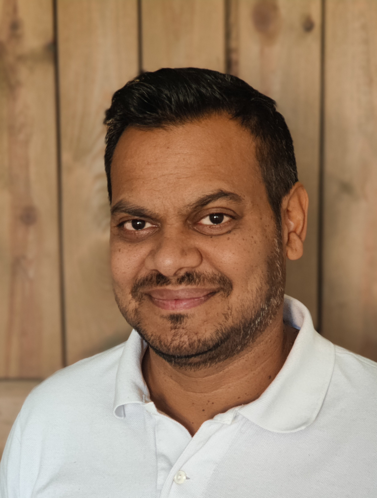
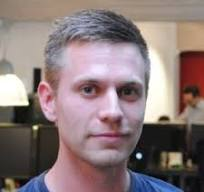
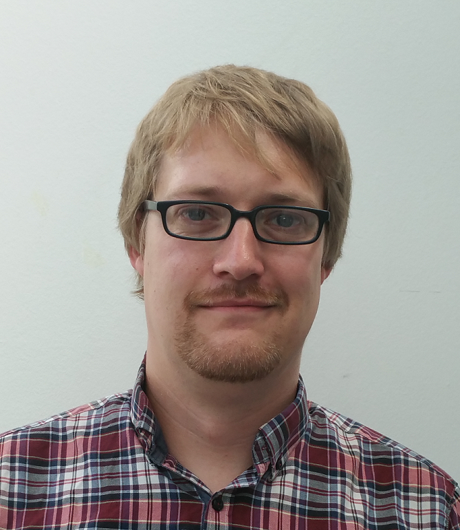

    <h1 align="center">Videoportal</h1>
    
Videoportal for <a href="https://www.via.dk/uddannelser/ingenioertrainee-software">Software Trainee 2025</a> på VIA

---

## :fontawesome-solid-circle-info: Information

På dette site kan du finde alle videoer fra undervisningen - både fra den synkrone og asynkrone del. I menuen til venstre finder du en liste over semestrene og kurserne, som er tilgængelige. Du kan finde videoer fra de forskellige kurser ved at klikke på det ønskede kursus. 

---

## :fontawesome-solid-users: Om os

- 

    **Richard Brooks**  
    Lektor  
    Underviser i [MSE1]() og [STA1]()  
    Kontakt: [:material-email:](mailto:rib@via.dk) [:fontawesome-brands-github:](https://github.com/RBrooksDK/) [:fontawesome-brands-linkedin:](https://www.linkedin.com/in/rbrooks-dk/)

- 

    **Kasper Knop**  
    Lektor  
    Underviser i [WEB1]()  
    Kontakt: [:material-email:](mailto:trmo@via.dk) [:fontawesome-brands-github:](https://github.com/TroelsMortensen) [:fontawesome-brands-linkedin:](https://www.linkedin.com/in/troels-mortensen-59930a60/)

- 

    **Troels Mortensen**  
    Lektor  
    Underviser i [PRO1](), [SEP1](), [PRO2]() og [SEP2]()  
    Kontakt: [:material-email:](mailto:trmo@via.dk) [:fontawesome-brands-github:](https://github.com/TroelsMortensen) [:fontawesome-brands-linkedin:](https://www.linkedin.com/in/troels-mortensen-59930a60/)

- 

    **Michael Viuff**  
    Lektor  
    Underviser i [SEP1](), [WS1](), [DBS1](), [SEP2](), og [WS2]()  
    Kontakt: [:material-email:](mailto:trmo@via.dk) [:fontawesome-brands-github:](https://github.com/TroelsMortensen) [:fontawesome-brands-linkedin:](https://www.linkedin.com/in/troels-mortensen-59930a60/)

## :fontawesome-solid-address-book: Kontakt

VIA Ingeniørtrainee  
Campus Horsens  
Banegårdsgade 2  
DK-8700 Horsens  

+45 87 55 00 20  
[horsens@via.dk](horsens@via.dk)  

**Åbningstider**  
Telefonerne er åbne:  
Mandag - torsdag kl. 07:30 – 15:30  
Fredag kl. 07:30 – 14:30